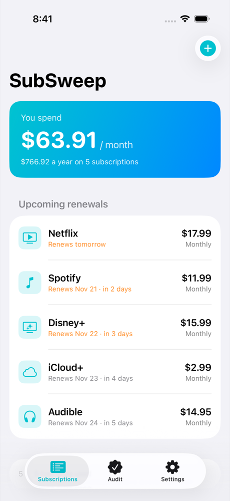
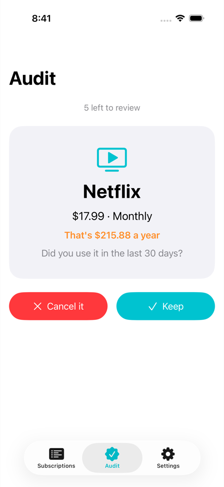
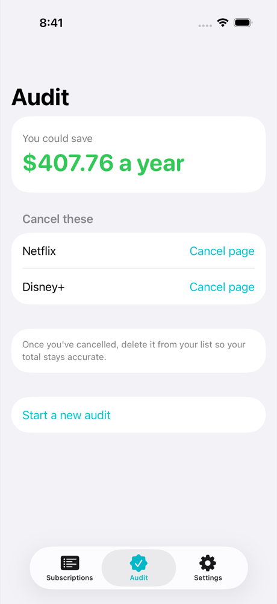
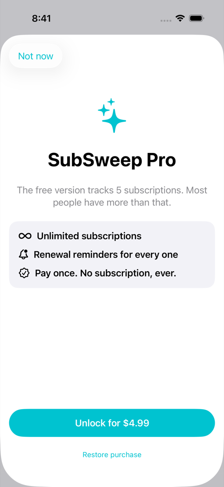

# SubSweep

A native iOS app that finds the subscriptions you forgot about. Add what you pay for, see the real monthly and yearly total, swipe Keep / Cancel in a quick audit to see what you'd save, get a reminder before each renewal, and jump straight to the service's cancel page. No bank login, and everything stays on the phone.

## Why this app

People are typing this app into search boxes and finding nothing:

- TikTok search, 7 days to 12 Nov 2026: "app to cancel subscriptions" had 154,584 searches with 0 matching videos ([TokConnect](https://tokconnect.com/guides/app-ideas/)).
- Google Trends, US: interest in "no subscription" is about 3x its 2022 level ([Shotmatic](https://shotmatic.app/blog/subscription-fatigue-app-opportunity)); "cancel Amazon Prime / Planet Fitness / Adobe" stay among the most-searched cancellations ([Corebits](https://terma.corebits.uk/blog/subscriptions-hardest-to-cancel)).

## Business model

Free for up to 5 subscriptions; **SubSweep Pro** is a one-time $4.99 unlock (non-consumable `com.lauchoy.subsweep.pro`), which matches the "no subscription" mood. At Apple's 15% Small Business Program rate that's about $4.24 a sale, so **~24 sales a month ≈ $100/mo**.

## Build and run

Requires Xcode 16+ and [XcodeGen](https://github.com/yonaskolb/XcodeGen).

```sh
brew install xcodegen
xcodegen generate
open SubSweep.xcodeproj
```

The `SubSweep` scheme runs with `SubSweep.storekit`, so the Pro purchase works in the Simulator without App Store Connect.

## Tests

```sh
xcodebuild test -project SubSweep.xcodeproj -scheme SubSweep \
  -destination 'platform=iOS Simulator,name=iPhone 17'
```

- `SubSweepTests`: totals across billing cycles, savings, free limit, persistence, renewal roll-forward.
- `SubSweepUITests`: add a popular service, add/delete a custom one, the audit and its savings, the free-limit paywall and unlock. `ScreenshotTests` captures the screenshots below.

UI tests launch with `-uiTesting` (in-memory data, purchase stubbed); `-seedSample` and `-seedFull` preload 2 or 5 subscriptions.

## Screenshots

| Subscriptions | Audit | Savings | Pro |
| --- | --- | --- | --- |
|  |  |  |  |

## Shipping to TestFlight

Needs an Apple Developer Program membership ($99/yr). Then: set `DEVELOPMENT_TEAM` in `project.yml`, create the app record for `com.lauchoy.subsweep` and the `com.lauchoy.subsweep.pro` in-app purchase in App Store Connect, archive, and upload.
